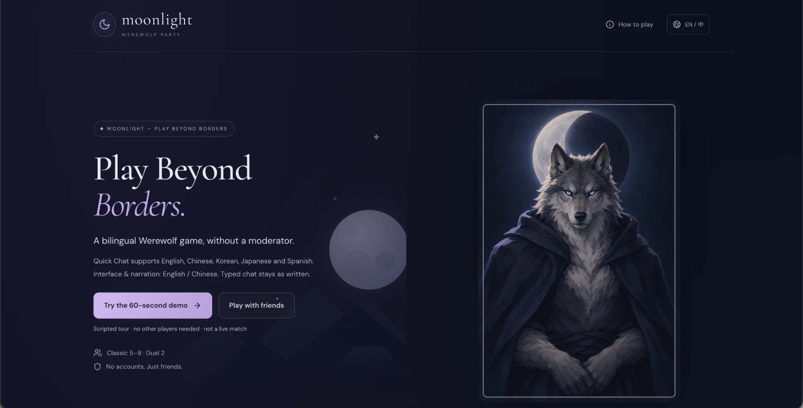
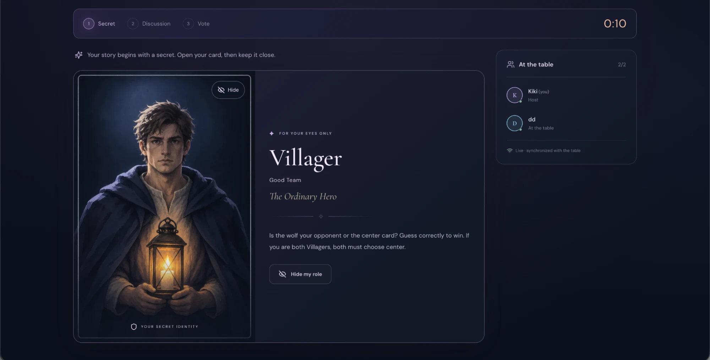
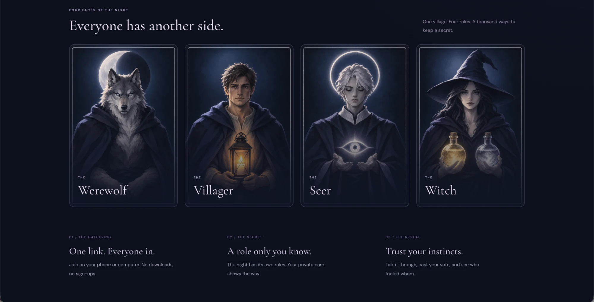
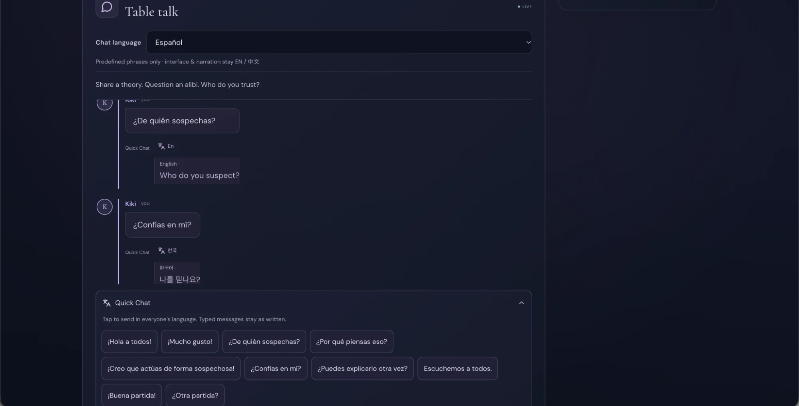

# Moonlight — Play Beyond Borders

A bilingual Werewolf game for friends that needs no moderator. Each player joins from their own phone or computer with a nickname and a room code. There are no accounts, downloads or payments.

**Try it:** [Play with friends](https://moonlight-werewolf-party.onrender.com/) · [60-second solo demo](https://moonlight-werewolf-party.onrender.com/demo.html?lang=en)
<sub>Hosted on a free server. The first visit can take about a minute while it wakes up.</sub>

| | |
|---|---|
|  |  |
|  |  |

## About this project

Moonlight is an independent product project by **Beibei (Kiki) Huang**, built for **Create a Multiplayer Game with OpenAI**, the October 2026 monthly challenge on Handshake's AI Skills Studio (Handshake × OpenAI). Results haven't been announced yet. The goal is to let friends who don't share a first language play Werewolf together, without anyone having to sit out as the moderator.

### My role

I owned the product from idea to launch: the concept, rules, privacy requirements, user flows and testing priorities. **The code was generated with AI coding tools.** I directed the work through requirements, reviews and test feedback, and decided what to fix next.

- **Defined the product:** a moderator-free game for 2–8 players with two modes. Classic (5–8 players: Werewolf, Seer, Witch, Villagers) is the full game. Duel (2 players plus a hidden center card) is a quick bluffing round.
- **Designed cross-language communication:** the interface and narration are in English and Chinese. Quick Chat has 10 preset phrases, and each player reads them in their own choice of English, Chinese, Korean, Japanese or Spanish. Typed messages stay as written.
- **Tested and iterated:** played through desktop and mobile flows and wrote bug and usability reports. I then prioritized fixes for fairness, reconnection, host handover and mobile layout across several releases.

### Product decisions worth discussing

| Decision | Why |
|---|---|
| Each night role's turn lasts the same fixed time, even if that player is dead or has already acted | If a turn ended early, players could work out who holds which role |
| Preset phrases instead of machine translation | A preset can't be mistranslated in an embarrassing way, nothing is sent to a translation service, and typed text keeps the speaker's own voice |
| Roles are assigned and checked on the server, and each phone receives only what that player is allowed to see | Nobody can find hidden roles by inspecting the browser |
| Discussion goes in seat order by default (30/45/60 seconds per speaker), with Open Discussion as an option | Beginners and second-language speakers get guaranteed time to speak |
| A tie gets speeches from the tied players, then exactly one runoff vote | Results stay decisive without endless re-votes |
| Hosting passes to another player if the host goes offline, and an offline speaker is skipped after 5 seconds | One dropped connection shouldn't stall the whole table |

## How to play

- **Classic (5–8 players).** The cast is 1–2 Werewolves, a Seer, a Witch and Villagers. Each night the wolves choose a target, the Seer checks one player, and the Witch may save the victim or poison someone. Each potion can be used once per game. During the day, players discuss and then vote in secret. A player voted out gets 30 seconds of last words. The village wins when every wolf is gone. The wolves win when they equal or outnumber everyone else.
- **Duel (2 players).** Three cards are dealt: two go to the players and one stays hidden in the center. Players talk for 90 seconds, then guess whether the wolf is the other player or the center card.
- **Getting in:** create a room, share the link or 6-character code, and the host starts once everyone is Ready. Refreshing the page in the same browser restores your seat.
- **Extras:** optional English/Chinese narration and piano music, Pack Chat for teams of two or more living wolves, and a scripted demo for trying the game alone.

## How it works

| Part | Files | Role |
|---|---|---|
| Game rules | `server/game.ts` | Deals roles with a cryptographic shuffle, runs every phase and vote, and builds a separate filtered view for each player |
| Server | `server/index.ts` | Express + Socket.IO: room codes, anonymous seat tokens, input validation (zod), rate limits and timers |
| Shared types | `shared/` | The message protocol, Quick Chat phrases and the public narration script |
| Client | `client/` | React + TypeScript (Vite). It only shows the view the server sends; it can't assign roles, advance time or decide a winner |
| Tests | `tests/` | Vitest suites, including full games played by 5–8 independently connected clients |

## Run locally

Requires Node.js 22 or newer.

```sh
npm ci
npm run build
npm start          # http://localhost:3001
npm run dev        # live-reload development at http://localhost:5173
npm test
```

To test several players on one computer, give each player a different browser or a private window. A second tab in the same browser resumes the same seat.

## Deploy

`render.yaml` deploys to Render's free plan as a single Node web service. No database or API keys are needed. Build command: `npm ci --include=dev && npm run build`. Start command: `npm start`. Health check: `/api/health`.

## Known limitations

- Rooms live in one server's memory, so a restart or redeploy ends active games.
- Free hosting sleeps when idle, so the first visit can be slow.
- Typed chat is not translated; only the Quick Chat presets are.

## Credits

Character art was created for this project (see [design/README.md](design/README.md)). The music is *Evening Fall (Piano)* by Kevin MacLeod (CC BY 4.0). Narration was rendered with MIT-licensed MeloTTS. Full notices are in [public/THIRD_PARTY_NOTICES.txt](public/THIRD_PARTY_NOTICES.txt).
